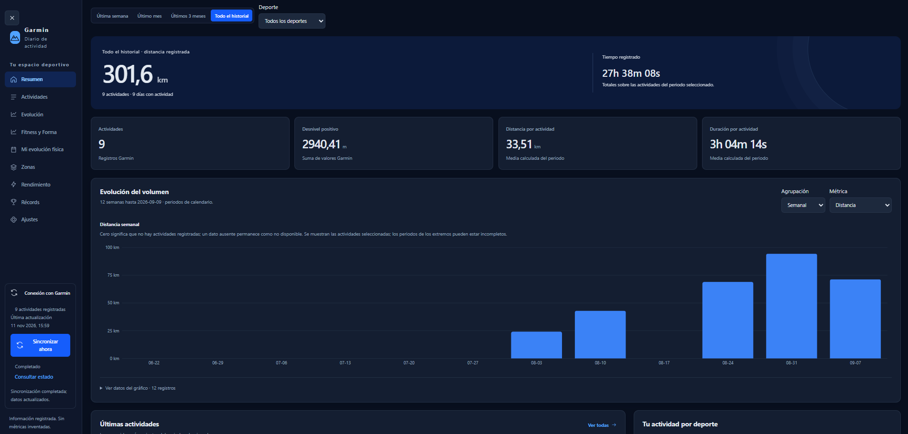
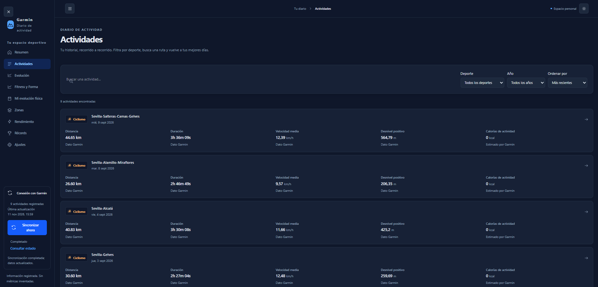
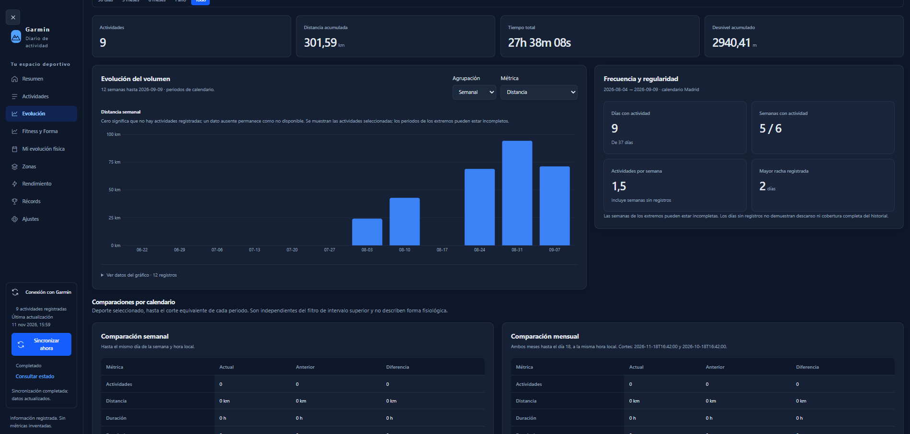
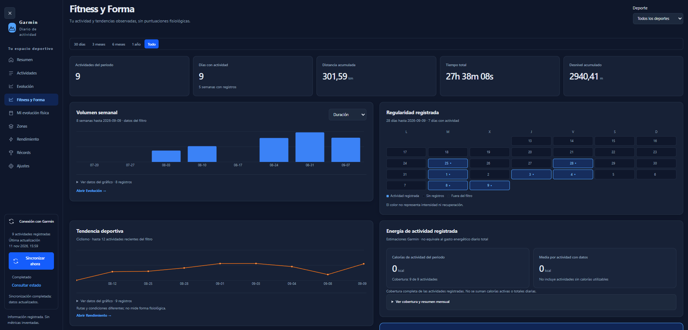
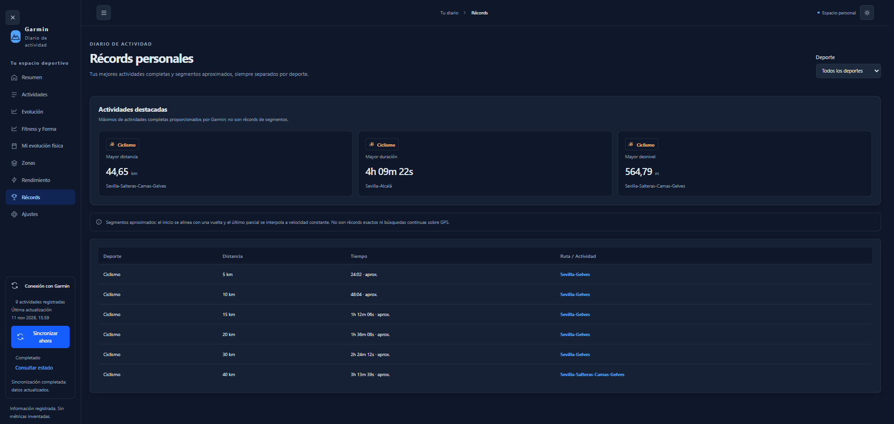
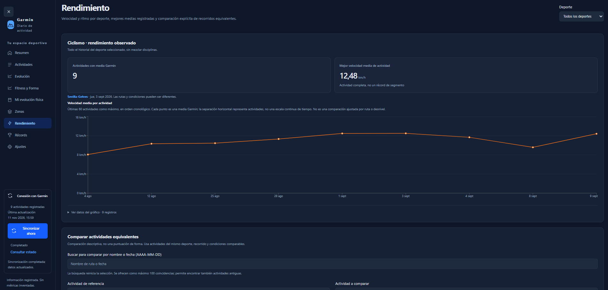
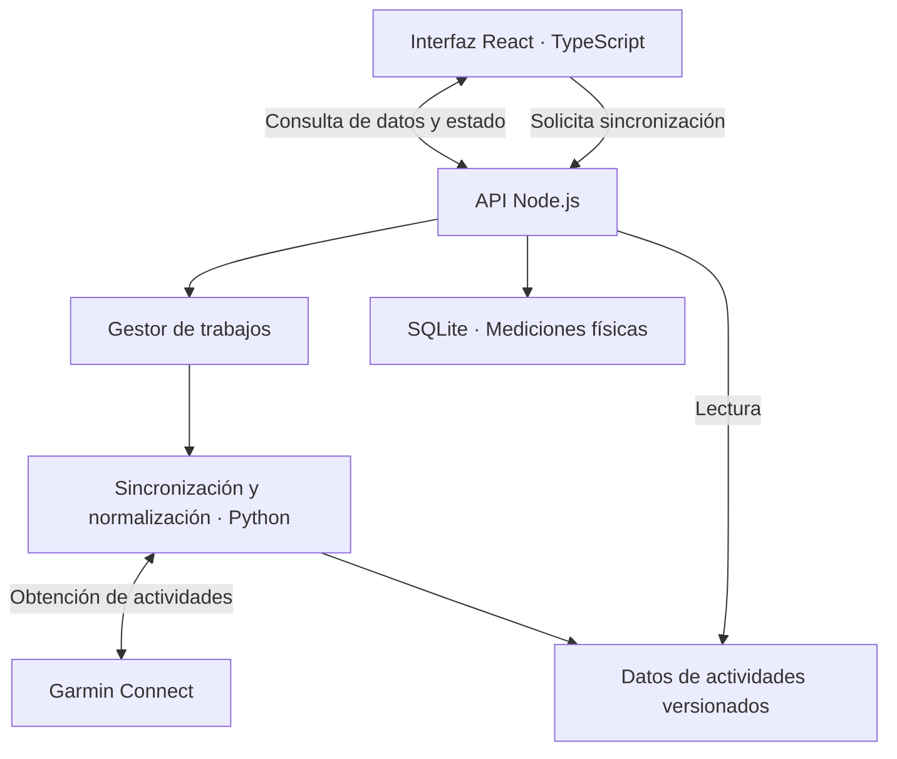

# Garmin Fitness Dashboard

**Tu actividad deportiva, organizada y explicada con los datos que realmente has registrado.**

Aplicación Full Stack integrada con Garmin Connect para explorar actividades, visualizar la evolución del entrenamiento y comparar el rendimiento observado desde una interfaz en español.

[Características](#características-principales) · [Cómo funciona](#cómo-funciona) · [Galería](#galería-visual) · [Tecnologías](#tecnologías) · [Arquitectura](#arquitectura-a-alto-nivel) · [Autor](#autor)

## Presentación

Garmin Fitness Dashboard nace para convertir un historial deportivo en una experiencia de consulta clara: saber cuánto has entrenado, encontrar una actividad, observar tu regularidad y volver a tus mejores recorridos.

Es un proyecto personal utilizado en producción que conecta **interfaz, backend y sincronización con un servicio externo**. Combina visualización de datos, navegación por actividades y análisis descriptivo, manteniendo visible la diferencia entre información registrada, cálculos y estimaciones.

El objetivo es facilitar la lectura del historial deportivo sin presentar datos incompletos como conclusiones sobre salud, fatiga o recuperación.

## Características principales

| Área | Qué permite hacer |
| --- | --- |
| **Resumen** | Consultar distancia, tiempo, desnivel y número de actividades, con filtros por periodo y deporte. |
| **Actividades** | Buscar por nombre, filtrar por deporte y año, ordenar por fecha, distancia o duración y recorrer el historial paginado. |
| **Detalle de actividad** | Consultar métricas y vueltas disponibles, visualizar ritmos o velocidades por vuelta y abrir el recorrido GPS bajo demanda. |
| **Evolución** | Explorar el volumen por semanas o meses, los días y semanas con actividad y las comparaciones entre periodos de calendario. |
| **Fitness y Forma** | Reunir volumen semanal, calendario de actividad, tendencias deportivas y calorías de actividad disponibles. |
| **Récords** | Identificar actividades de mayor distancia, duración y desnivel por deporte, además de mejores tiempos aproximados calculados a partir de vueltas. |
| **Rendimiento** | Revisar velocidad o ritmo por disciplina y comparar dos actividades tras confirmar que sus recorridos y condiciones son comparables. |
| **Zonas cardíacas** | Consultar tiempos y porcentajes por zona cuando Garmin proporciona esos datos, con indicación de cobertura. |

La interfaz incluye temas claro y oscuro. Los gráficos y mapas se cargan de forma diferida, y las vistas contemplan estados de carga, errores y ausencia de datos.

## Cómo funciona

1. **Sincroniza con Garmin Connect.** El botón «Sincronizar ahora» solicita al backend un trabajo de actualización. La interfaz permite consultar su estado y distingue entre finalización completa, parcial y error.
2. **Explora tu historial.** Desde Resumen puedes elegir un periodo y un deporte. En Actividades puedes localizar una sesión mediante búsqueda y filtros, y abrir su detalle.
3. **Consulta lo que hay disponible.** Cada actividad muestra sus métricas y vueltas según los datos recibidos. El mapa se solicita al abrir el recorrido, cuando existe información GPS.
4. **Analiza el contexto.** Evolución muestra volumen y regularidad; Fitness y Forma reúne las tendencias; Récords destaca mejores actividades; Rendimiento permite revisar medias y comparar sesiones seleccionadas.

La sincronización es incremental y publica versiones de datos sin recompilar la interfaz. Si una actualización falla, se conservan los datos publicados anteriormente.

## Galería visual

### Resumen

Vista general del periodo seleccionado: distancia, tiempo, actividades, desnivel y evolución del volumen.

### Actividades

Historial con búsqueda por nombre, filtros por deporte y año, ordenación y acceso al detalle de cada sesión.

### Evolución

Volumen de actividad, frecuencia y regularidad, junto con comparaciones entre periodos de calendario.

### Fitness y Forma

Volumen semanal, calendario de actividad registrada, tendencia deportiva y resumen de calorías de actividad disponibles.

### Récords

Actividades destacadas por deporte y mejores tiempos aproximados por distancia, diferenciados de los récords exactos de segmentos.

### Rendimiento

Histórico de velocidad o ritmo por deporte y selección de actividades para una comparación explícita de recorridos equivalentes.

## Tecnologías

| Capa | Tecnologías utilizadas |
| --- | --- |
| **Frontend** | React, TypeScript y Vite |
| **Navegación y estado** | React Router y Zustand |
| **Interfaz** | CSS y Tailwind CSS |
| **Visualización** | Recharts |
| **Mapas** | Leaflet y React Leaflet |
| **Backend** | Node.js, JavaScript y API HTTP con `node:http` |
| **Integración Garmin** | Python y biblioteca `garminconnect` |
| **Persistencia** | Archivos JSON versionados para actividades; SQLite con `better-sqlite3` para el módulo de mediciones físicas |

## Arquitectura a alto nivel

- **`src/`** reúne las páginas, componentes, estado, acceso a datos y cálculos de presentación.
- **`backend/` y `server.js`** gestionan la API, los trabajos de sincronización y el acceso al almacenamiento.
- **`fetch/`** contiene la integración con Garmin Connect, la normalización y la publicación de datos versionados.

Los resúmenes, los detalles y las coordenadas GPS se consultan por separado. Esto permite explorar el historial sin descargar todos los recorridos de entrada.

El módulo de mediciones físicas mantiene su almacenamiento separado de Garmin y requiere su configuración específica en el backend.

## Privacidad y precisión de los datos

- **Datos Garmin:** indican la procedencia; algunos valores ya son cálculos o estimaciones del dispositivo o de Garmin. Las calorías y el VO₂max se identifican como estimaciones.
- **Cálculos y aproximaciones:** la aplicación calcula totales, medias y comparaciones. Los tiempos de segmentos derivados de vueltas se etiquetan como aproximados; comparar recorridos requiere confirmación del usuario.
- **Valores ausentes:** no se convierten automáticamente en cero ni se inventan pulsaciones o tiempos por zona. La falta de registros no demuestra descanso ni un historial completo.
- **Métricas fisiológicas:** los modelos CTL, ATL y TSB solo aparecen con TSS Garmin suficiente. Son modelos de carga, no mediciones de fatiga, recuperación o preparación fisiológica.

Las credenciales, los datos personales de actividad y las rutas GPS se mantienen fuera de esta documentación. Las capturas deben evitar información que el autor no quiera compartir.

## Autor

**Alfonso Carrasco Salgueiro**

Proyecto personal de desarrollo Full Stack: integración de servicios, backend, tratamiento de datos e interfaz de análisis deportivo.

